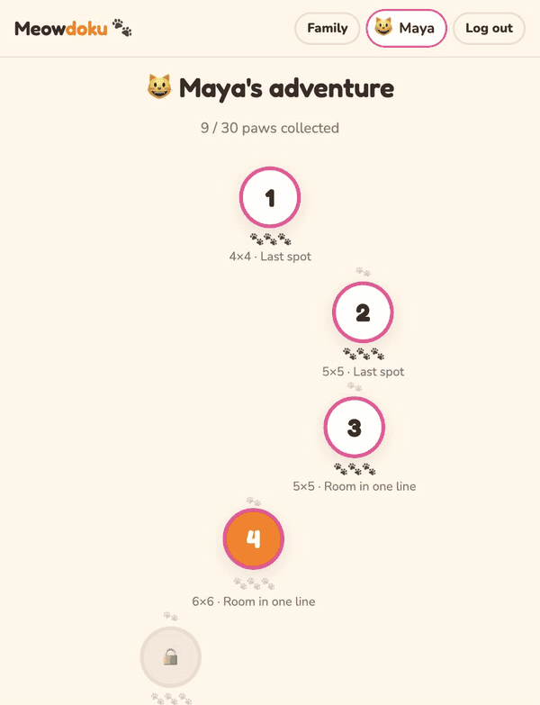

# Hi, I'm Ujjaval

I own the engineering side of taking a product from demo to a platform the business can run on. That covers the architecture and the vendor integrations underneath it. It also covers the team, which I mentor and guide so it keeps shipping.

I work best in highly regulated domains, on small teams. Small enough to act with high agency and ship with engineering rigour and velocity.

## Shipped and running

- **[Meowdoku](https://meowdoku.ujjaval.ca)**. Logic puzzles for kids. The hint button explains the next step, then lets the kid make the move. `TypeScript` · `React` · `Cloudflare Workers` · `D1`
- **[Protocol Ward](https://protocolward.ai)**. DNS-layer defence on hardware you own. Nothing is sent off-device for analysis. `Go` · [code](https://github.com/ujjaval-verma/protocolward.ai)
- **[Nimbus KB](https://nimbus.ujjaval.ca)**. A docs chatbot that answers only from the company's own documents, with citations. Claude first, Gemini as the fallback. The demo is password-gated. `TypeScript` · `Hono` · `Cloudflare Workers` · [code](https://github.com/ujjaval-verma/nimbus-kb)

 

## Open source

- **[engineering-rigor](https://github.com/ujjaval-verma/engineering-rigor)**. A Python template where the engineering rules are hooks, not hopes. `Python` · `uv` · `just`
- **[skills](https://github.com/ujjaval-verma/skills)**. Markdown playbooks I use to hold coding agents to a senior engineer's standard. `SKILL.md`
- **[slide-ai](https://github.com/ujjaval-verma/slide-ai)**. Markdown in, Beamer PDF out, over HTTP. Compile errors an agent can act on. `TypeScript` · `Fastify` · `LaTeX`
- **[agentic-cab-rides](https://github.com/ujjaval-verma/agentic-cab-rides)**. An AI agent that books cab rides. It books only past structural confirmation gates, and keeps a replayable action log. `Python` · `FastAPI` · `Claude`

## Elsewhere

